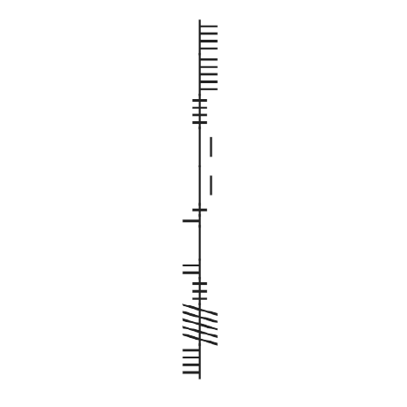
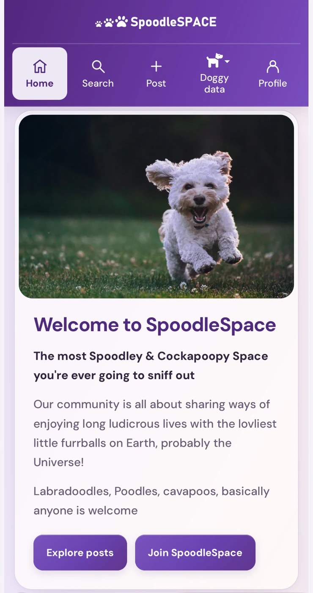
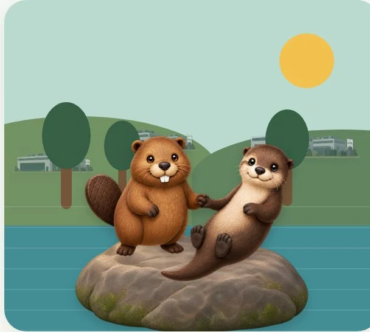
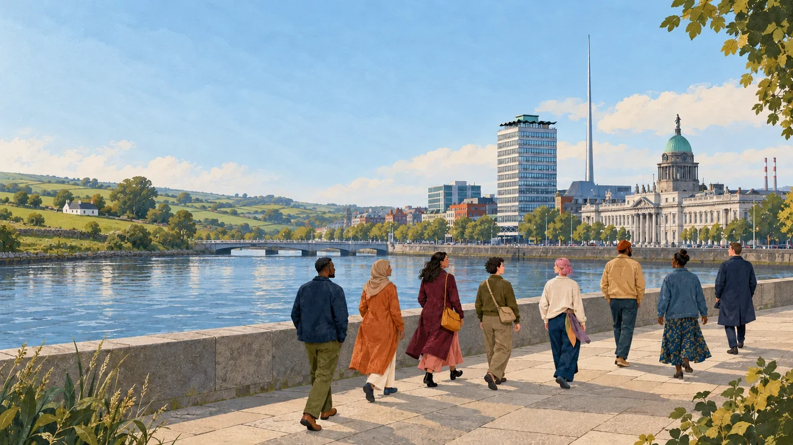
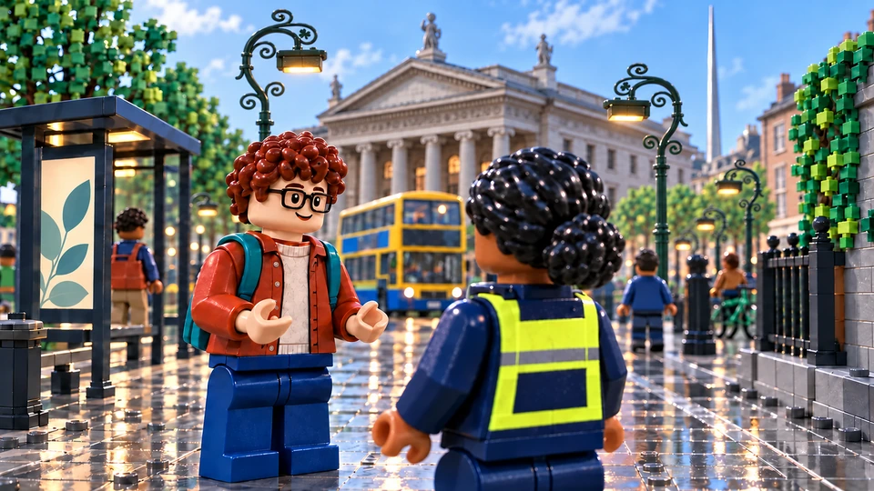
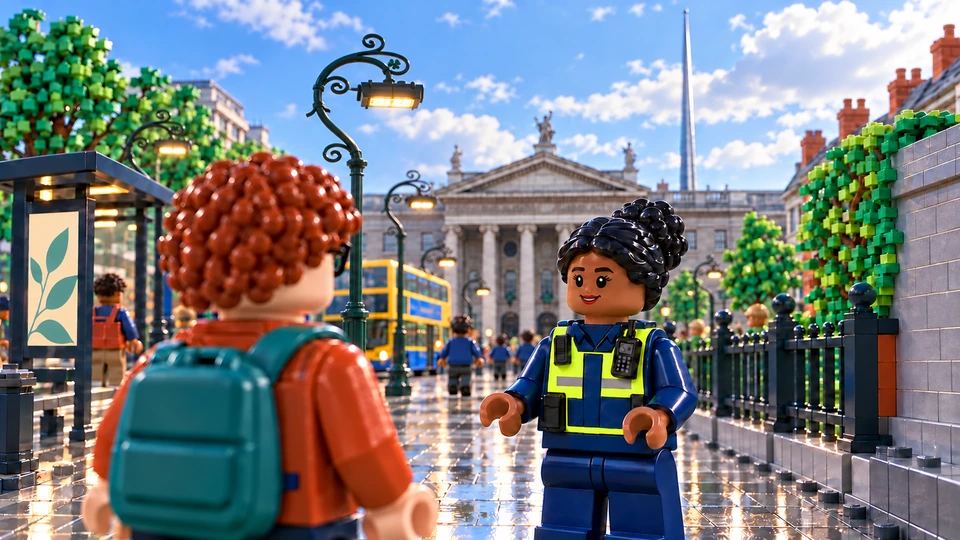
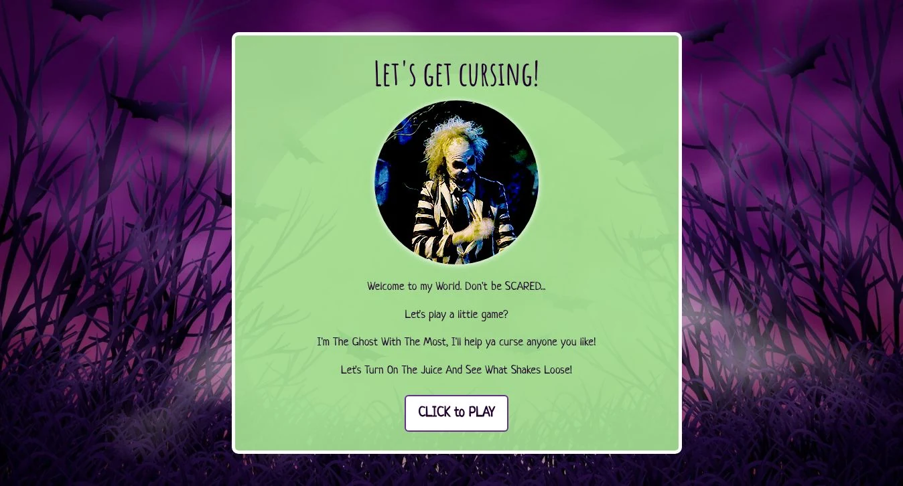
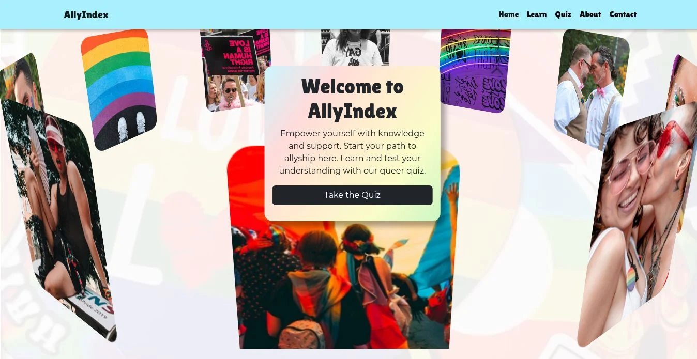
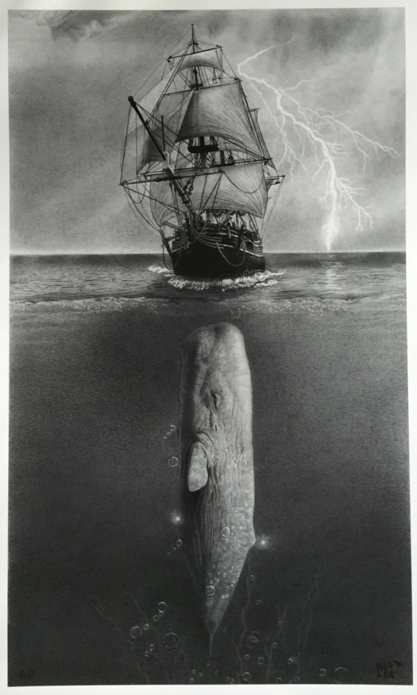

#  Sam Tim Solutions

**Sam O’Brien-Olinger · Software & Community Development · Dublin, Ireland**

<picture>
  <source media="(max-width: 680px)" srcset="assets/profile/ui/hero-mobile.svg">
  
</picture>

I create bespoke digital experiences to empower and connect communities.

  
  

  
  

  
  
  
  
  

<h2><picture><source media="(max-width: 680px)" srcset="assets/profile/ux/work-mobile.svg"></picture></h2>

Community resources, full-stack applications and playful learning. Open a site to try it, or view the code to see how it is built.

### Latest repository details

- Saggart & Citywest Together — Community website for Saggart and Citywest: local supports, facts, history and events. Built with HTML, CSS and JavaScript. Languages: JavaScript 43.8%, HTML 42.4%, CSS 13.5%.
- SpoodleSpace — React frontend for a dog-community social app, paired with a Django REST API. GitHub Pages hosts an interface preview. Languages: JavaScript 88%, CSS 11.6%, Other 0.4%.
- Beaver v Otter — JavaScript-based learning game exploring energy consumption and everyday decisions in a data-centre river ecosystem. Languages: JavaScript 44.8%, HTML 28.2%, CSS 27%.
- A New Life in Ireland — Interactive learning about migration to Ireland through twelve fictional journeys. Built with React and TypeScript. Languages: TypeScript 93.1%, CSS 4.9%, JavaScript 1.5%, Other 0.5%.
- Stopped: Both Sides — JavaScript learning game exploring public and Garda perspectives through branching choices, saved progress and sourced explanations. Languages: JavaScript 95%, CSS 4.6%, HTML 0.4%.
- Know Yellowknife — "Know Yellowknife" is a versatile educational tool, online resource, and digital hub designed to foster connection, belonging, and cultural understanding within Yellowknife. Languages: HTML 62.4%, JavaScript 37.6%.
- The White Whale vs Old Thunder — A mobile-first, Battleship-inspired browser game built in plain HTML, CSS and JavaScript. You play as Moby Dick. Languages: JavaScript 47.4%, CSS 44.3%, HTML 8.3%.

### Saggart & Citywest Together

**Community connection** · HTML, CSS, JavaScript

A community resource connecting neighbours with local history, practical supports and opportunities to take part. Explore local events and activities, a directory of supports, and a source-linked history and learning gallery.

  
  

### SpoodleSpace

**Full-stack social application** · React frontend, Django REST API

A dog-community social app for sharing posts, exploring member profiles and connecting around a common interest. The GitHub Pages site is an interface preview; sign-in and account features need the configured backend.

  
  

[View the Django REST API code](https://github.com/SamOBrienOlinger/drf-spoodle-space).

### Beaver v Otter

**Playful learning** · JavaScript, HTML, CSS

A choice-based learning game about river ecosystems, data centres and collective action. Choose a beaver or an otter, work through challenges and explore how ecological evidence can inform decisions about the water they share.

  
  

### More to explore

#### A New Life in Ireland

**Interactive learning** · React, TypeScript, Vite 
An interactive learning resource about migration and settlement, told through twelve fictional journeys. Follow a five-stage journey, consider choices and explanations, and explore the information hub and Fact or Fiction activities.

  
  

#### Stopped: Both Sides

  
  

**Interactive learning** · JavaScript, HTML, CSS 
A branching learning game about rights, responsibilities and fair decision-making in Ireland. Explore sourced explanations from public and Garda perspectives, with saved progress.

  
  

#### Beetlejuice

**Playful browser experience** · JavaScript, HTML, CSS 
A Halloween hackathon project inspired by the world of Beetlejuice. Create a personalised three-part curse, explore film history and enjoy themed imagery and sound in an interactive fan experience.

  
  

#### Know Yellowknife

**Place-based learning** · HTML, JavaScript 
An educational tool and digital hub for connection, belonging and cultural understanding in Yellowknife. Explore local topics, then try the replayable quiz.

  
  

#### AllyIndex

**Team project** · Interactive learning 
Explore LGBTQ+ terminology, diverse history and allyship through self-guided learning and a knowledge quiz.

  
  

[My fork](https://github.com/SamOBrienOlinger/24-7-hackathon-team9)

#### The White Whale vs Old Thunder

**Literary game** · JavaScript, HTML, CSS 
A mobile-first, Battleship-inspired browser game. Play as Moby Dick and strike all five coordinates of the hidden Pequod to sink it; one miss lets Captain Ahab kill the whale and leaves the ship intact.

  
  

[Browse the full interactive portfolio](https://samobrienolinger.github.io/SamOBrienOlinger/#work) · [Portfolio data model](#portfolio-entity-relationship-diagram)

<h2><picture><source media="(max-width: 680px)" srcset="assets/profile/ux/experience-mobile.svg"></picture></h2>

**Junior Software Developer · Department of Social Protection** 
Executive Officer, bringing software development together with a background in public service, research and community work.

**JavaScript · TypeScript · React · Python · Django · REST APIs · SQL · PostgreSQL · HTML & CSS · Git**

<h2><picture><source media="(max-width: 680px)" srcset="assets/profile/ux/research-mobile.svg"></picture></h2>

**PhD in Sociology, University College Dublin.** Research shapes how I understand people, test assumptions and design for context.

[Police, Race and Culture in the ‘New Ireland’](https://link.springer.com/book/10.1057/9781137490452) · Author, Palgrave Macmillan 
[Routledge International Handbook of Police Ethnography](https://www.routledge.com/Routledge-International-Handbook-of-Police-Ethnography/Fleming-Charman/p/book/9780367539399) · Contributing author 

[Research & background](docs/research-and-background.md)

<h2><picture><source media="(max-width: 680px)" srcset="assets/profile/ux/approach-mobile.svg"></picture></h2>

**Understand the people. Simplify the information. Build something useful.**

My background spans sociology, public policy, education and community development. I bring that perspective to frontend and backend work, with attention to accessibility, maintainability and clear user experience.

Diploma in Full Stack Software Development · Code Institute, Advanced Front End · [View credential](https://www.credential.net/profile/samobrienolinger167622/wallet)

<h2><picture><source media="(max-width: 680px)" srcset="assets/profile/ux/contact-mobile.svg"></picture></h2>

Have a digital project, a research question or a community idea? I’d be glad to hear about it.

  

  
  

[Portfolio](https://samobrienolinger.github.io/SamOBrienOlinger/) · [Back to work](#work)

## Portfolio entity relationship diagram

The portfolio is authored in HTML. It contains nine software project cards, each with preview artwork and links, and a separate background section with four credentials. The carousel reads the project data from the repository’s front-end source and renders the cards dynamically.

© 2026 Sam O’Brien-Olinger · Sam Tim Solutions · [Setup & credits](docs/repository-guide.md) · [Profile maintenance](docs/profile-layout.md)
